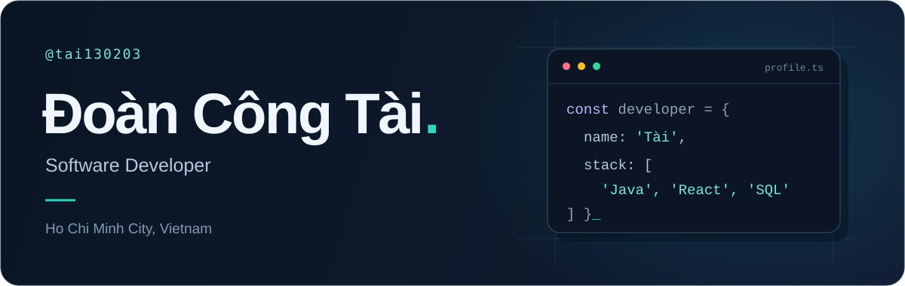
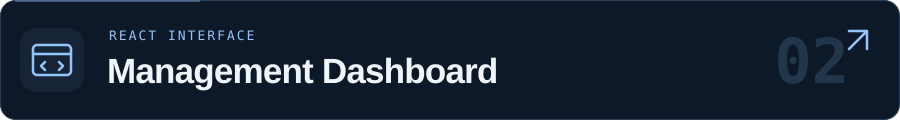

<picture>
  <source media="(max-width: 600px)" srcset="./assets/header-mobile.svg">
  
</picture>

 

I build <b>Java desktop applications</b> and <b>React interfaces</b>, with a focus on practical management tools.

  
  
  
  
  
  

 

## Selected work

A desktop application for book catalogs, readers, borrowing, returns, and reporting.

`Java` `Swing` `Hibernate`

 

A React interface for employees, documents, calendars, profiles, and requests.

`React` `JavaScript` `Sass`

 

**[Explore all repositories →](https://github.com/tai130203?tab=repositories)**
