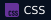

  

  
  
  

## Hi, I’m Tài

I’m a software developer based in **Ho Chi Minh City, Vietnam**. My public projects cover desktop applications, web interfaces, and relational data.

- **Desktop applications:** Java and Swing tools for library management.
- **Web interfaces:** React pages for employees, documents, calendars, and requests.
- **Data access:** SQL scripts, JDBC, and Hibernate.

## What I work with

  
  
  
  
   
  
  
  
  

## Selected work

- **[Library Management · SE_104](https://github.com/tai130203/SE_104)** — Book catalogs, readers, borrowing, returns, and reports in Java/Swing.
- **[Management Dashboard · QLDA](https://github.com/tai130203/QLDA)** — Employee, document, calendar, profile, and request interfaces in React.
